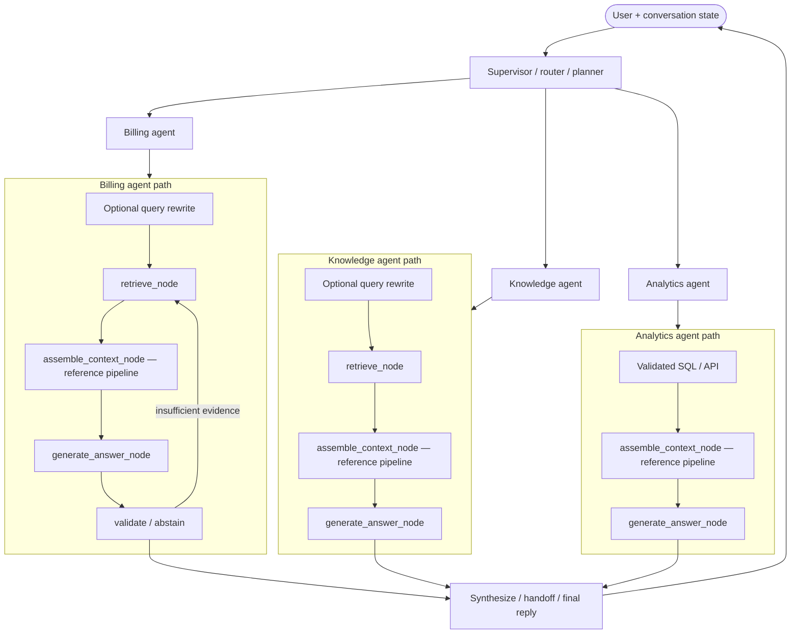
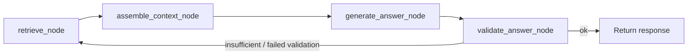

# Contexting Strategies

**Reference implementation** of current **best practices** for **context assembly** in RAG and multi-agent systems: after retrieval returns candidates and before the model generates an answer, **what goes into the prompt**—and how you **prove** it is correct, safe, and token-efficient.

The patterns match [AI-System-Architecturing-Engineering → contexting](https://github.com/CaioHAndradeLima/AI-System-Architecturing-Engineering/tree/main/contexting). This repo ships **production-style defaults** (pipeline assembler, sufficiency gate, measure gates, CI profiles) plus a **fixed regression corpus** so you can compare changes before pointing the same commands at your data.

### Where context assembly runs (multi-agent stack)

In production, **orchestration** picks which agent acts; each agent still does retrieve → **assemble context** → generate. This repo implements and gates the **assemble** step (highlighted)—per agent, with tenant/task-scoped evidence. Supervisor routing and deployment are yours; the assembly patterns here are what we treat as **current baseline**.



Single-agent RAG is the same picture with **one** agent box: no supervisor merge, one retrieve → assemble → generate chain.

---

## 1. What is “context” in a multi-agent system?

**Context** is everything the model is allowed to treat as **evidence** for this turn—not the system instructions you trust, but the **retrieved chunks, structured query results, and selected conversation history** bundled into the user-facing prompt.

In a single-agent RAG app that is usually one assembly step. In **multi-agent** setups each agent often gets a **different slice** of evidence (billing agent vs catalog agent), but the same rules apply: only authorized, task-relevant, budget-sized text with traceable source IDs.

Typical pipeline position:

```text
User + thread state
    → (optional) rewrite query for retrieval
    → retrieve candidates          ← reranking-strategies
    → CONTEXT ASSEMBLY             ← this repo (best-practice pipeline)
    → prompt template + policy     ← prompting docs
    → LLM → answer (+ citations)
    → validate / abstain / retry   ← can loop (see §4)
```

Five inputs this repo renders together ([context info for output](https://github.com/CaioHAndradeLima/AI-System-Architecturing-Engineering/blob/main/contexting/context-info-for-output.md)): system policy, retrieved evidence, structured results (SQL/API), conversation history, current request. Implementation: `full_prompt.py` / `evaluate-full` → `context_info_for_output`.

**Task-scoped context** (multi-agent): `task_context.py` filters candidates by team/agent before assembly—same pipeline, smaller exposure.

---

## 2. How do you guarantee the *right* context?

You cannot “guarantee” with prompts alone; you **measure and gate** assembly against labeled expectations.

| Mechanism | What it checks | Reference implementation |
| --- | --- | --- |
| **Golden relevance labels** | Required doc IDs appear in the assembled prompt | `evidence_coverage` in `metrics.py` |
| **Multi-hop hop labels** | Each sub-question’s evidence is represented | `evaluate_multihop` / hop coverage |
| **Scoring \(S(d)\)** | Pick chunks by relevance, freshness, authority, task fit—not raw BM25 order only | `weighted_score` assembler, `scoring_math` in `evaluate-full` |
| **Rerank before assemble** | Better ordering of the same candidates | Heuristic rerank in `measure`; bridge from [reranking-strategies](https://github.com/CaioHAndradeLima/reranking-strategies) |
| **Query resolution** | Follow-ups like “did we fix it?” retrieve on a **resolved** query | `query_rewrite.py`, `threads.json`, `query_resolution` in `evaluate-full` |
| **Sufficiency gate** | If coverage is too low, **do not** pretend the context is enough | `sufficiency.py`; pairs with abstention metrics |
| **Live judges (optional)** | LLM rubric on assembled context + answer | `measure --live-llm` (OpenAI or Cursor via `--llm-provider cursor`) |

**Production-shaped check (recommended on every change):**

```bash
pip install -e .
context-lab evaluate-pipeline --profile ci-contexting-eval --output reports/pipeline-eval.json
context-lab check-measure --profile ci-contexting-eval --report reports/pipeline-eval.json
```

That runs assembly on the golden set, abstention scenarios, and multi-hop lift, then applies thresholds in [config/measure_profiles.json](config/measure_profiles.json). Details: [docs/PIPELINE_EVAL.md](docs/PIPELINE_EVAL.md).

---

## 3. How do you avoid *wrong* context or *too much* context?

| Risk | Mitigation | Reference implementation |
| --- | --- | --- |
| **Cross-tenant / ACL leak** | Filter before assembly; never trust the model to ignore forbidden chunks | Pipeline step 1 (`context_pipeline.py`); `unauthorized_leak` metric; naive assembler **intentionally** leaks for contrast |
| **Prompt injection in docs** | Treat retrieved text as untrusted; scan/sanitize | `reliability.py`, injection sample `doc-016` |
| **Duplicates & noise** | Dedupe, diversity caps, don’t fill budget with redundant hits | Pipeline steps 2–5; `redundancy_rate` |
| **Token bloat** | Budget, compact at sentence boundaries, selective history | `compacting.py`; conversation strategies `last_n` / `summary_plus_recent` |
| **Wrong agent seeing everything** | Task-specific retrieval + assembly | `task_context.py` |
| **Over-confident answers** | Abstain when evidence is thin | Sufficiency gate + `abstain_correct` / `abstain_correct_rate` |

Full algorithm (steps 1–8): [context-algorithm.md](https://github.com/CaioHAndradeLima/AI-System-Architecturing-Engineering/blob/main/contexting/context-algorithm.md) — implemented in `pipeline_acl_dedupe_score_diverse`.

---

## 4. Loops during context assembly and the wider cycle

Contexting is usually **linear**, but the **system around it** often loops:



| Loop type | When | Covered in this repo |
| --- | --- | --- |
| **Retrieve → assemble → validate → retrieve again** | Validation fails or evidence too thin | `langgraph_workflow.py` models nodes; validation uses lexical groundedness + abstain; graph spec in `evaluate-full` → `langgraph` |
| **Multi-hop retrieval** | One query is not enough; several sub-queries | `multihop.py` — multiple retrievals, one assembled prompt |
| **Conversation + rewrite** | Resolve “it” then retrieve | `query_rewrite.py` + thread fixtures |
| **Measure / CI loop** | Change assembler → rerun eval → gate | `evaluate-pipeline` + GitHub `measure-gate.yml` |

LangGraph itself is not a dependency; node names match [context-assembly-langchain-langgraph.md](https://github.com/CaioHAndradeLima/AI-System-Architecturing-Engineering/blob/main/contexting/context-assembly-langchain-langgraph.md) so you can drop the same nodes into your orchestrator.

---

## 5. Assembly strategies in this project — when to use which

All strategies share the same retriever in the reference stack (BM25 on `data/documents.json` for regression). They differ in **how candidates become prompt text**.

| Strategy | Assembler name | Use when | Trade-off |
| --- | --- | --- | --- |
| **Naive retrieval order** | `naive_retrieval_order` | Regression baseline only—**do not ship** | High coverage sometimes, **can leak ACL**, noisy |
| **Weighted \(S(d)\)** | `weighted_score` | Score-then-pack when ACL/dedupe already upstream | No ACL/dedupe/diversity in this assembler |
| **Full pipeline** | `pipeline_acl_dedupe_score_diverse` | **Recommended default** for new work | ACL + dedupe + score + diversity + compacting |
| **Simple doc MVP** | `simple_document_mvp` | Minimal Q&A prompt shape (question + cited chunks) | [Simple document question](https://github.com/CaioHAndradeLima/AI-System-Architecturing-Engineering/blob/main/contexting/context-simple-document-question.md) |
| **Multi-hop assembly** | `multihop_fair_budget_pipeline` | Questions needing several retrieval hops | More retrieval cost; better hop coverage vs single query |
| **History + evidence split** | `pipeline_with_*` in threads | Follow-ups with token split between chat and docs | See `evaluate-scenarios` |

**Reference regression snapshot (120-token budget, bundled fixtures):**

| Strategy | Evidence coverage | Unauthorized leak rate |
| --- | ---: | ---: |
| Naive retrieval order | 0.81 | 0.14 |
| Weighted \(S(d)\) | 0.67 | 0.00 |
| Full pipeline | 0.67 | 0.00 |

Compare strategies offline: `context-lab evaluate` or `context-lab measure --profile ci-all-strategies`.

Pair with **reranking-strategies**: export ranked lists (`export_context_candidates.py`) → `data/rerank_report_sample.json` → rerank bridge in `evaluate-full`.

---

## 6. Metrics — what to look at in reports

### 6.1 Scorecard (`evaluate-pipeline`)

After `evaluate-pipeline`, open `scorecard` in the JSON:

| Field | Meaning |
| --- | --- |
| `assembly.evidence_coverage` | Fraction of must-have golden docs present |
| `assembly.redundancy_rate` | Overlap between included chunks |
| `assembly.citation_traceability` | Citation IDs appear in rendered prompt |
| `assembly.unauthorized_leak` | Any forbidden tenant in prompt (want **0** for pipeline) |
| `assembly.assembly_ms_p95` | Assembly latency |
| `assembly.abstain_correct_rate` | Sufficiency/abstain matches query answerability |
| `abstention.abstain_correct_rate` | Same, abstention-focused pass on golden |
| `multihop.lift_over_baseline` | Multi-hop assembly vs one-shot retrieval |

Gates for CI profile **`ci-contexting-eval`**: [PIPELINE_EVAL.md](docs/PIPELINE_EVAL.md).

### 6.2 Strategy comparison (`measure`)

`summary.<strategy>` adds per-strategy means; with `--live-llm`:

| Field | Meaning |
| --- | --- |
| `judge_evidence_sufficiency` | Context quality (0–4) |
| `judge_groundedness` / `judge_correctness` | Answer quality (0–4) |
| `llm_usage_total` | Calls and cost estimate (OpenAI path) |

Profile **`nightly-live`** + `./scripts/measure-live-local.sh` (Cursor, no OpenAI key required).

### 6.3 Full guide coverage (`evaluate-full`)

One JSON with every contexting guide track (analytical SQL, LangGraph trace, trade-off flags, maturity snapshot). Map: [docs/LAB_COVERAGE.md](docs/LAB_COVERAGE.md).

---

## 7. Commands (cheat sheet)

| Goal | Command |
| --- | --- |
| **PR / regression gate** | `evaluate-pipeline --profile ci-contexting-eval` + `check-measure` |
| Compare assemblers | `evaluate` or `measure --profile ci-all-strategies` |
| Multi-hop, history, abstain only | `evaluate-scenarios` |
| Full best-practice checklist vs docs | `evaluate-full --output reports/full.json` |
| Live generate + judges | `measure --live-llm` or `measure-live-local.sh` |
| Docker CI | `./scripts/docker-ci.sh ci-contexting-eval` |

Requires **Python 3.10+**:

```bash
python3 -m venv .venv && source .venv/bin/activate
pip install -e .                    # reference pipelines + eval
pip install -e '.[llm-judge,llm-cursor]'   # optional live judges
```

---

## 8. Adopting this in production

1. **Keep the pipeline assembler and gates** — treat `ci-contexting-eval` as the minimum bar; tune thresholds in [config/measure_profiles.json](config/measure_profiles.json) for your SLAs.
2. **Replace fixtures** — swap `data/documents.json`, `golden.json`, and scenario files for your tenant, ACLs, and labeled queries; rerun `evaluate-pipeline` on every assembly change.
3. **Pair with retrieval** — context assembly cannot fix bad candidates; use [reranking-strategies](https://github.com/CaioHAndradeLima/reranking-strategies) upstream.
4. **Add live judges when ready** — `measure --live-llm` (OpenAI or Cursor) on a sampled golden set; keep offline gates on every PR.
5. **Deploy separately** — this repo does not include Fargate/LangGraph hosting; see `maturity.production_deployment_only` in `evaluate-full` for ops items outside assembly code.

Bundled fixture scores are for **regression between strategies**, not published SLAs.

---

## 9. Development

```bash
python -m unittest discover -s tests -v
```

**GitHub Actions:** [`measure-gate.yml`](.github/workflows/measure-gate.yml) (offline profiles + `ci-contexting-eval`); optional [`measure-live.yml`](.github/workflows/measure-live.yml) (OpenAI; skips if no key).

**Data fixtures:** `data/documents.json`, `golden.json`, `multihop_golden.json`, `threads.json`, `structured_results.json`, etc.—see repo `data/` directory.

**Related:** [Contexting docs](https://github.com/CaioHAndradeLima/AI-System-Architecturing-Engineering/tree/main/contexting) · [PIPELINE_EVAL.md](docs/PIPELINE_EVAL.md) · [LAB_COVERAGE.md](docs/LAB_COVERAGE.md)
